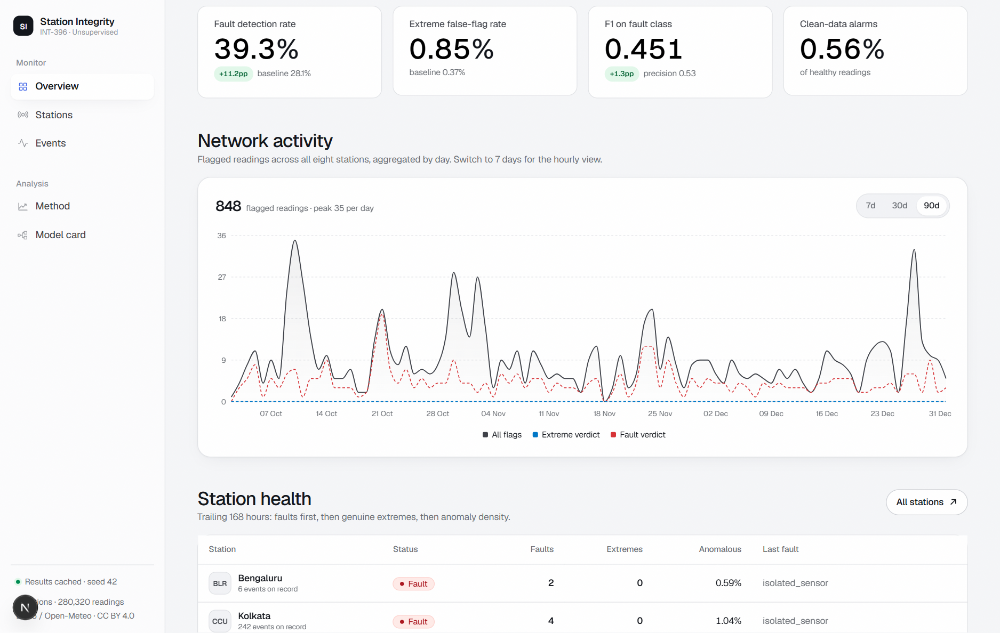

# INT-396 · Sensor Fault Discovery in Automatic Weather Station Networks

Unsupervised detection of failing weather-station sensors, with genuine extreme events separated from
instrument faults. Real ERA5 data, synthetic fault and extreme injection, custom implementations of the
syllabus algorithms, one FastAPI service, one Next.js dashboard.

## Run everything

Double-click **`run.bat`** in the project root. It installs dependencies if missing, runs the full
pipeline if results are absent, starts the API and the dashboard in separate windows, and opens
`http://localhost:3000`.

The dashboard proxies its interactive range switch through its own `/api/timeline` route, so the
client never talks cross-origin to the API.

Manual equivalent:

```bash
cd backend
pip install -r requirements.txt
python -m src.acquisition.fetch_open_meteo      # download ERA5 data
python -m src.acquisition.build_dataset         # tidy long format
python -m src.simulation.build_simulation       # inject faults + extremes, build labels
python -m src.evaluation.run_experiment         # detect, discriminate, evaluate, export
python -m src.evaluation.export_rules           # association-rule comparison
python -m src.evaluation.generate_figures       # report figures
python -m uvicorn main:app --port 8000
```

```bash
cd frontend
npm install
npm run dev
```

## What it does

| Stage | Module | Output |
|---|---|---|
| Acquire | `src/acquisition/` | 8 stations × 8,760 hours × 4 sensors |
| Simulate | `src/simulation/` | 6 fault types, 4 extreme types, ground-truth labels |
| Feature | `src/features/` | 11 features per reading, reference-period scaling |
| Detect | `src/detection/consensus_detector.py` | 5 unsupervised models, 3-of-5 vote |
| Discriminate | `src/detection/extreme_discriminator.py` | FAULT vs EXTREME rule tree |
| Evaluate | `src/evaluation/` | metrics JSON, detections CSV, figures |
| Serve | `main.py` | FastAPI over the result files |
| Show | `frontend/` | Next.js dashboard |



## Unsupervised guarantee

Ground-truth columns are written by the simulation and read **only** by the evaluation module.
`src/features/leakage_guard.py` raises if a label column ever reaches a feature frame, the detector
input or the detector output, and `run_experiment.py` strips them at load. No model in
`src/algorithms/` imports a label.

## Custom algorithms (Unit I–V)

All implemented from scratch with NumPy; scikit-learn is not used anywhere in the model path.

| File | Unit | Contents |
|---|---|---|
| `distance_metrics.py` | I | Euclidean, Manhattan, cosine similarity/distance, pairwise |
| `kmeans.py` | II | k-Means with k-Means++ init, inertia, empty-cluster handling |
| `kmedoids.py` | II | PAM BUILD + SWAP |
| `minibatch_kmeans.py` | II | mini-batch update with per-cluster learning rate |
| `cluster_validation.py` | II | WCSS, silhouette, Davies–Bouldin, elbow curve |
| `hierarchical.py` | III | single/complete/average/Ward linkage, merge matrix, dendrogram cut |
| `dbscan.py` | III | eps-neighbourhood, core/border/noise, chunked scoring |
| `pca.py` | IV | eigendecomposition of the covariance matrix, reconstruction error |
| `anomaly_detectors.py` | V | custom Isolation Forest and LOF |
| `association_rules.py` | V | Apriori and FP-Growth with support, confidence, lift, conviction |
| `scaler.py` | II | custom StandardScaler and MinMaxScaler |

## Results

See `documentation/experiments.md` for the measured numbers and their interpretation, and
`documentation/methodology.md` for the full method.

## Documentation

- `documentation/data_sources.md` — dataset, licences, citations, preprocessing
- `documentation/methodology.md` — faults, extremes, features, detector, discriminator
- `documentation/metrics_definitions.md` — every metric with its formula
- `documentation/experiments.md` — experiment log, tables, observations
- `documentation/assets/` — figures used in the report

## Tests

```bash
cd backend
python -m tests.test_algorithms
python -m tests.test_metrics
python -m tests.test_leakage_guard
```

## Troubleshooting

**Port already in use.** `run.bat` checks ports 8000 and 3000 and automatically falls back to 8010
and 3010, printing the URLs it actually used.

**"Another next dev server is already running".** Next.js 16 allows only one dev server per project
directory. Close the other server window, or run `taskkill /F /IM node.exe` if it is orphaned.

**Dashboard shows "Backend results are not reachable".** The API must be running before the page is
loaded. It reads pre-computed files from `backend/results/`, so the pipeline has to have been run at
least once.

**Regenerating results.** Delete `backend/results/metrics_summary.json` and run `run.bat`, or run the
pipeline manually (see above).
